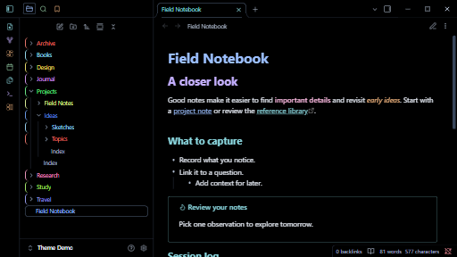
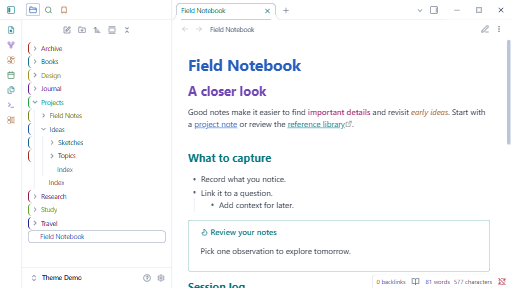

# Pure OLED Rainbow

Pure black and pure white Obsidian surfaces with colourful folders, menus and note headings.

Version 1.0.0. Modes supported: Dark and light. Tested in Obsidian 1.15.1 on Windows.

The 20-colour sequence rotates by sibling order and shifts according to the parent folder. Colours remain stable as you browse. Sorting or moving folders can change their place in the sequence.

## Preview

## Install manually

1. Download `manifest.json` and `theme.css` from [release 1.0.0](https://github.com/tutivsoft-com/obsidian-theme-pure-oled-rainbow/releases/tag/1.0.0).
2. Put both files in `.obsidian/themes/Pure OLED Rainbow/` in your vault.
3. Open **Settings > Appearance** and select **Pure OLED Rainbow**. Choose a supported base colour scheme.

See the [original design plan](PLAN.md). [MIT license](LICENSE).
